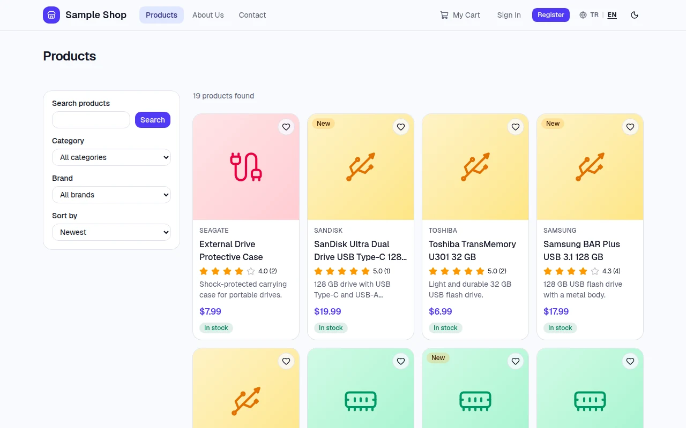
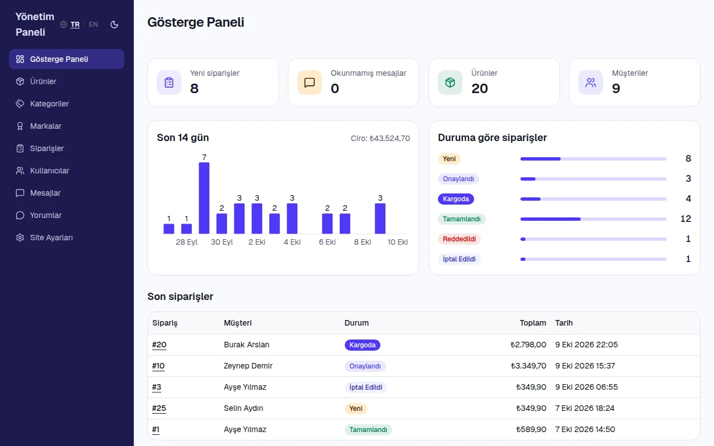

# Storefront Starter

[](LICENSE)


<!-- The "tests" badge is a fixed picture: there is no CI. Change it by hand if the tests ever fail. -->

A 2018 school project (PHP and CodeIgniter), rebuilt in 2026 as a starting point for students:
clone it, run it, make it your own shop. The original code is still in the git history.

<p align="center">
  <br>
  <sub>The shop</sub>
</p>
<p align="center">
  <br>
  <sub>The admin panel</sub>
</p>

## What is included

- **Storefront:** catalogue with filters and search, product pages with an image gallery, star
  ratings and comments, favourites, cart, checkout, and a customer account with orders and
  printable invoices.
- **Admin panel:** dashboard with a 14-day chart, products and images (resized on upload),
  categories, brands, orders with status rules, customers, messages, comments, site settings.
- **English by default, with Turkish one click away**, **light and dark mode**, and a
  **markdown editor** for product and page texts.
- **Safe by default:** Argon2 passwords, JWT sessions that end after a password change, admin rights
  checked on the server for every route, and tests that walk all of them.
- **Not included:** payments, e-mail sending, password reset and anonymous comments.

## Quick start

You need Git, [Miniconda](https://docs.conda.io/) and a bash shell (on Windows: WSL2 or Git Bash,
see "Windows notes" below). Nothing is installed system-wide: two conda environments provide Python
3.14, Node.js 24 and PostgreSQL 18.

```bash
git clone <repository-url> && cd <repository-folder>

conda create -n ecommerce -c conda-forge python=3.14 nodejs=24 -y    # Python and Node.js
conda create -n pg18 -c conda-forge postgresql=18 -y                 # the PostgreSQL server programs

cp backend/.env.example backend/.env     # edit it first, see below
scripts/db.sh init                       # first time: creates .pgdata/, the database and its role, starts the server
conda activate ecommerce
pip install -r backend/requirements-dev.txt

cd backend
python -m app.migrate                    # creates the tables
python seed.py                           # sample catalogue, site settings and the admin account
uvicorn app.main:create_app --factory --reload --port 8000    # the API: leave it running

# in a second terminal, from the project root (Node.js comes from the conda environment):
conda activate ecommerce
cd frontend && npm install && npm run dev
```

Edit `backend/.env` before `scripts/db.sh init`: set `SECRET_KEY` (`openssl rand -hex 32`),
`ADMIN_PASSWORD` (8 or more characters, not starting with `change-me`) and the password inside
`DATABASE_URL` (it becomes the password of the database role). The file is git-ignored.

Open <http://localhost:5173> and log in with `ADMIN_EMAIL` and `ADMIN_PASSWORD` to reach the admin
panel. The API documentation is at <http://localhost:8000/api/docs> (on while `API_DOCS_ENABLED=true`,
as in `backend/.env.example`). Without `conda activate`, put `conda run -n ecommerce` in front of a
command. `scripts/db.sh stop`, `start` and `status` control the database server; `scripts/db.sh reset`
empties the database, so that you can migrate and seed again. Something does not work? See
"Common errors" below.

## Tests

```bash
cd backend && pytest                          # the database server must run; it uses its own database
cd frontend && npm run typecheck && npm test && npm run build
scripts/e2e.sh                                # browser tests in a throw-away stack
```

`scripts/e2e.sh` drives a real browser: run `npx playwright install chromium` once in `frontend/`, or
use the Google Chrome you already have with `E2E_CHANNEL=chrome scripts/e2e.sh`. The backend tests
use the database `ecommerce_test_main` and leave the development database alone. Lint:
`ruff check app tests seed.py` and `ruff format --check app tests seed.py` in `backend/`.

## Make it yours

1. The shop identity: the site settings in the admin panel, or `SITE_SETTINGS` in `backend/seed.py`.
2. The sample catalogue: `CATEGORIES`, `BRANDS` and `PRODUCTS` in `backend/seed.py`. Start the sample
   data again: `scripts/db.sh reset`, then migrate and seed.
3. The currency: `CURRENCY` in `frontend/src/lib/format.ts`.
4. The texts: `frontend/src/locales/tr/*.json` and `frontend/src/locales/en/*.json`.
5. The session length: `ACCESS_TOKEN_MINUTES` in `backend/.env`.
6. A new backend feature: a migration (`backend/migrations/0002_price_alerts.sql`), then a repository
   function, a service if there are business rules, a router, a schema and a test in `backend/tests/api/`.
7. A new page: a file in `frontend/src/features/` and a route in `frontend/src/app/routes.tsx`.

## License

MIT, see [LICENSE](LICENSE).

## More

<details>
<summary><b>Project layout</b></summary>

```
backend/
  app/
    main.py           application factory (create_app), routers, CORS, /api/media
    config.py         settings from the environment and backend/.env
    db.py             psycopg connection pool (autocommit, dict rows)
    migrate.py        migration runner (python -m app.migrate)
    security.py       Argon2 password hashing and JWT tokens
    deps.py           get_current_user, require_admin, pagination
    errors.py         ApiError and the JSON error format
    middleware.py     request body size limit (413 before authentication)
    media.py          URLs of product images
    routers/          HTTP layer: paths, input and status codes
    services/         business rules (accounts, cart, orders, images)
    repositories/     SQL, one module per area
    schemas/          Pydantic models at the API boundary
    static/           placeholder.svg, copied to the upload folder at startup
  migrations/         hand-written SQL files, applied in name order
  tests/              pytest: api/ (HTTP tests), unit/, migration and seed tests
  seed.py             sample catalogue, site settings and accounts
frontend/
  src/
    app/routes.tsx    React Router route table
    lib/api.ts        the only HTTP layer (fetch, token, error codes)
    components/       shared components; components/ui/ holds shadcn/ui components
    features/         pages, components and hooks per feature (catalog, cart, account, auth, admin, pages)
    layouts/          store, account and admin layouts
    locales/          Turkish and English UI texts (tr/ and en/)
screenshots/         the two pictures of this README
scripts/db.sh        starts, stops and inspects the local PostgreSQL server, and resets the database
scripts/e2e.sh       runs Playwright end-to-end tests against an isolated stack
compose.yml          three containers: database, API, web server (not tested yet)
```

</details>

<details>
<summary><b>Architecture and design decisions</b></summary>

### Two routers, two jobs

There are two routers in this stack, and they do different jobs.

| Where | Tool | Question it answers | Example |
|---|---|---|---|
| Browser | React Router | Which page should be shown for this URL? | `/products/42` shows the product page |
| Server | FastAPI `APIRouter` | Which function handles this HTTP request? | `GET /api/products/42` returns JSON |

The address bar shows page URLs. The page calls API URLs in the background. FastAPI never renders
pages: it returns JSON, and React builds the screen in the browser. That is what "single-page
application" means.

### Backend layers

```
HTTP request -> routers/ (input, authentication, status codes) -> services/ (business rules)
             -> repositories/ (SQL) -> PostgreSQL
```

- Pydantic models in `schemas/` are used only at the API boundary. Database rows are converted to them.
- Unit prices and order totals are computed on the server from the product row. A price sent by the
  client is never trusted.
- Stock is decremented by a guarded `UPDATE`, inside the transaction that creates the order.

### Frontend

- `features/` holds each feature's pages, components and hooks.
- `lib/api.ts` is the only HTTP layer. It attaches the token and turns error codes into exceptions.
- `app/routes.tsx` is the route table. The guards in `components/guards.tsx` decide what the browser
  shows.
- `locales/` contains localized JSON strings for Turkish (`tr/`) and English (`en/`), accessed reactively via `useLocale`.
- Theme system (`useTheme`) toggles between light, dark, and system modes using Tailwind OKLCH CSS variables.
- `RichTextViewer` safely parses markdown descriptions into structured React elements without `dangerouslySetInnerHTML`.

### Access control and money

Hiding the admin pages in React is only a convenience. The real check is `require_admin` in FastAPI:
a customer who calls an admin endpoint gets 403, and an anonymous request gets 401. Every
authenticated request loads the user from the database, so the role comes from the database and not
from the token, and an inactive user is refused at once.

Prices are stored as `NUMERIC(12,2)` and returned as strings with two decimals (`"1299.90"`). The
currency is USD (`CURRENCY` in `frontend/src/lib/format.ts`) and the frontend formats the amounts.
`cost_price` is returned only by admin endpoints; public product reads never select it.

### Design decisions

- **Plain SQL with psycopg 3** and a connection pool, with no ORM. The SQL is in
  `app/repositories/`, and every value is passed as a parameter (`%s`).
- **Hand-written migrations** in `backend/migrations/`, applied in name order by
  `python -m app.migrate`. Each applied file is recorded with its SHA-256 checksum. To change the
  schema, add a new file. Never edit a file that has been applied: the runner stops with an error.
- **Argon2 password hashing** (pwdlib). Password hashes are never returned by the API.
- **JWT bearer tokens:** HS256, with the claims `sub`, `tv`, `iat` and `exp`. `tv` is the token
  version of the user: a password change, an admin password reset or a deactivation raises it and
  ends every older session. The lifetime is set by `ACCESS_TOKEN_MINUTES` (60 by default). The
  client sends `Authorization: Bearer <token>`.
- **Stable error codes:** errors look like `{"detail": "insufficient_stock"}`. The frontend maps the
  codes to localized messages (Turkish or English depending on the active locale), so no message text is parsed.
- **Pagination** on every list: `page` (from 1) and `page_size` (1 to 100), answered with `items`,
  `total`, `page` and `page_size`.

</details>

<details>
<summary><b>Security notes and what to do before you put it on the internet</b></summary>

- **Token storage.** The browser keeps the JWT in `localStorage`, under the key `ecommerce.token`.
  This is simple, but any script that runs on the page can read it. A cross-site scripting (XSS) bug
  would therefore expose the token. The app is written to avoid XSS: user text and server text are
  shown as plain text, markdown descriptions are safely parsed into React elements with URL
  sanitization, and the frontend never uses `dangerouslySetInnerHTML`. An HttpOnly cookie would
  hide the token from scripts, but it brings other design work, such as protection against cross-site
  request forgery. This starter does not use cookies.
- **Admin screens are hidden as a convenience only.** The API enforces admin rights on every
  `/api/admin/*` route.
- **Secrets** stay in `backend/.env`, which is git-ignored. Only the `.env.example` files are committed.
- **CORS** allows only the origins listed in `CORS_ORIGINS`. In development the Vite proxy makes the
  browser's requests same-origin anyway.

### Before you put it on the internet

This starter is safe to run on your own machine. A public deployment needs a few things that the
application does not do for you:

- **Rate limiting.** Nothing limits login, registration or contact attempts. Argon2 makes each
  guess expensive for the server as well, so put a rate limiter in front of the app (a reverse proxy
  such as nginx, Caddy or Traefik).
- **A reverse proxy with TLS**, which also sets security headers (`Content-Security-Policy`,
  `Strict-Transport-Security`, `X-Frame-Options`) and a request size limit (`client_max_body_size`
  in nginx). The app refuses bodies over 256 KB (image uploads: 2 MB plus overhead) by itself.
- **Keep the API documentation off.** `API_DOCS_ENABLED` is `false` unless it is set to `true`;
  `backend/.env.example` turns it on for development. Or keep it behind your own login.
- **Real secrets:** a generated `SECRET_KEY`, a strong database password and a strong admin password.
- **Known limitation:** the admin form refuses to save a product that changed since it was opened
  (for example after a sale) instead of merging the two versions: reload and edit again.

</details>

<details>
<summary><b>Running with Docker (not tested yet)</b></summary>

`compose.yml`, `backend/Dockerfile`, `frontend/Dockerfile` and `frontend/nginx.conf` describe the same
application as three containers: PostgreSQL 18, the API, and an nginx web server that serves the built
frontend and forwards `/api` to the API. **These files have not been run with Docker yet.** Treat
them as a starting point, read them before you rely on them, and fix what does not work. Compared
with the setup above, only the host in `DATABASE_URL` changes: `localhost` becomes the service name
`db`.

```bash
cp .env.example .env     # then edit it: POSTGRES_PASSWORD, APP_DB_PASSWORD, SECRET_KEY, ADMIN_EMAIL, ADMIN_PASSWORD
docker compose up --build
docker compose exec backend python seed.py     # once: sample data and the admin account
```

Open http://localhost:8080 (the port is `WEB_PORT` in `.env`). `docker compose down` stops the
containers and keeps the data in the `db-data` and `uploads` volumes; `docker compose down -v` deletes
the data as well.

Notes:

- The root `.env` is for Docker only. When you run the API by hand it reads `backend/.env`.
- Use letters and digits in `APP_DB_PASSWORD`: it is placed inside the `DATABASE_URL`.
- The API logs in as the role `ecommerce`, which is not a superuser. The init script runs only when
  the `db-data` volume is created. A stack started before this change keeps its old superuser login
  until `docker compose down -v` (which deletes the data).
- The nginx configuration limits login and registration to a few requests per second. The API now
  sends `X-Frame-Options`, `Referrer-Policy` and `Cache-Control: no-store` itself; nginx adds
  `Content-Security-Policy` and repeats the others for the pages (see
  "Before you put it on the internet" in the security notes). It does not provide TLS:
  put a TLS-terminating proxy or your hosting provider's load balancer in front for a public server.
- The Content-Security-Policy blocks the Swagger UI at `/api/docs`, which loads a script from a CDN.

</details>

<details>
<summary><b>Common errors</b></summary>

- **Port 5432 is busy.** `scripts/db.sh start` fails because another PostgreSQL server (or another
  process) listens on the port. Find it on Linux with `ss -ltnp | grep 5432`, then stop it. Or use
  another port in `DATABASE_URL`: the server takes its port from that URL. The server's own log is
  `.pgdata/server.log`.
- **`pg_ctl not found ... (create the pg18 conda env first)`.** The `pg18` environment has no server
  programs, for example because it was created with only the client library. Check with
  `ls "$(conda info --base)/envs/pg18/bin/pg_ctl"`. If the file is missing, remove the environment
  with `conda env remove -n pg18` and create it again with the command in step 2.
- **Wrong Python version.** The backend needs Python 3.14 from the `ecommerce` environment. Check with
  `conda run -n ecommerce python --version`. If you see another version, activate `ecommerce` or use
  `conda run -n ecommerce`.
- **`DATABASE_URL is not set`.** `python -m app.migrate` and the tests read `DATABASE_URL` from
  `backend/.env` (an exported variable wins); `scripts/db.sh` reads only that file. `python seed.py`
  reports a missing value as `database_url Field required`. Run the Python commands from `backend/`,
  and check that the file exists and contains the variable.
- **Tests fail with connection errors.** PostgreSQL is stopped. Run `scripts/db.sh status`, then
  `scripts/db.sh start`.
- **`SECRET_KEY must have at least 32 characters` or `must be replaced with a generated value`.** The
  placeholder is still in `backend/.env`. Generate a value with `openssl rand -hex 32`.
- **`ADMIN_PASSWORD must be at least 8 characters and not a placeholder`.** Set a real password in
  `backend/.env` and run the seed again. A refused seed writes nothing.
- **Turkish letters do not match in search** (for example, an uppercase `Şarj` [charging] does not match `şarj`).
  The database locale must be UTF-8. Check it with
  `scripts/db.sh psql -c "SELECT datname, datcollate, datctype FROM pg_database"`; the `ecommerce` row
  should show a UTF-8 locale such as `en_US.UTF-8`. If it does not, stop the server, delete `.pgdata/`
  (this deletes the local data), set `LANG` (and `LC_ALL`, if you use it) to an installed UTF-8 locale
  (see `locale -a`), then run `init`, the migrations and the seed again. Note also that the Turkish
  dotless `ı` is a different letter from `I`: a search for `KILIF` does not find `Kılıf` [case].
- **`uvicorn` cannot find `app.main` or `.env`.** Run the command from `backend/`. The settings and the
  seed read `.env` from the current directory.
- **Port 8000 or 5173 is busy.** Stop the other process. The Vite proxy target is fixed to port 8000 in
  `frontend/vite.config.ts`, so change it there if the API runs on another port.

</details>

<details>
<summary><b>Windows notes</b></summary>

- `scripts/db.sh` is a bash script that uses Unix sockets. Use WSL2 (recommended: run everything inside
  the Linux distribution) or Git Bash.
- Without bash, start PostgreSQL by hand with the programs of the `pg18` environment. The commands below
  follow similar steps to `scripts/db.sh`, with different options. The project has not tested them
  on native Windows.

  ```bat
  rem Anaconda Prompt, in the project root, with the pg18 environment active (conda activate pg18)
  initdb -D .pgdata -E UTF8 -U postgres -W -A scram-sha-256
  pg_ctl start -D .pgdata -l .pgdata\server.log -w -o "-p 5432 -c listen_addresses=localhost"
  psql -h localhost -p 5432 -U postgres -d postgres
  ```

  In `psql`, create the role and the database, using the password from `DATABASE_URL`:

  ```sql
  CREATE ROLE ecommerce LOGIN CREATEDB PASSWORD 'your-password';
  CREATE DATABASE ecommerce OWNER ecommerce;
  ```

  Stop the server with `pg_ctl stop -D .pgdata -m fast -w` and check it with `pg_ctl status -D .pgdata`.
- Use `copy` (Command Prompt) or `Copy-Item` (PowerShell) instead of `cp`.
- Docker avoids the bash script and the conda environments altogether, see
  "Running with Docker".

</details>
